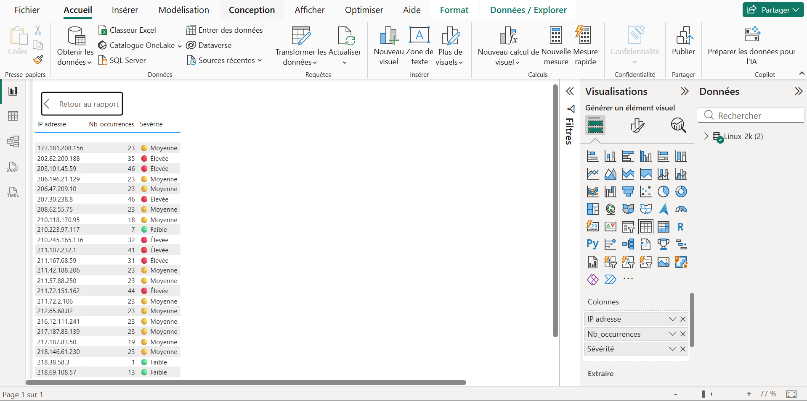
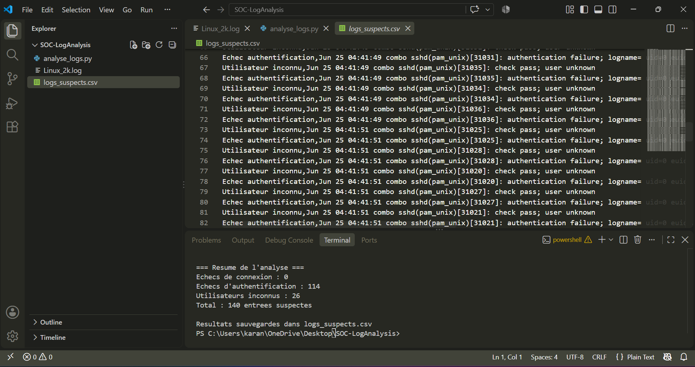
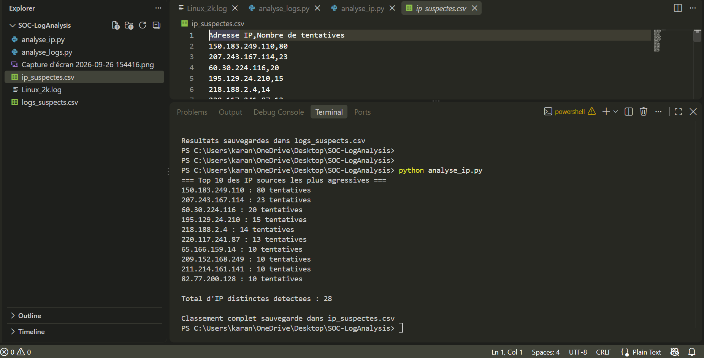
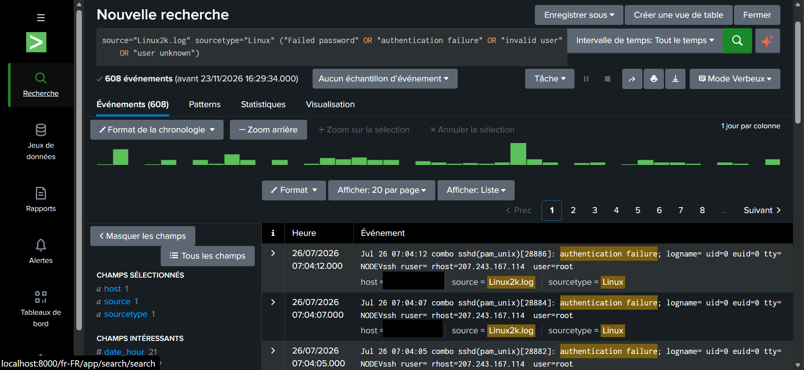
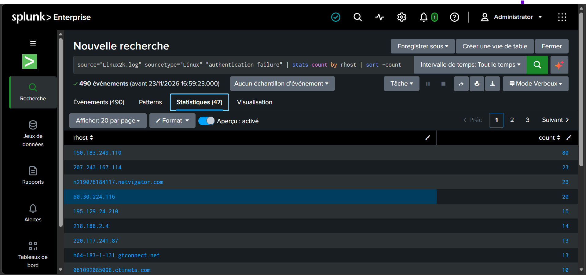
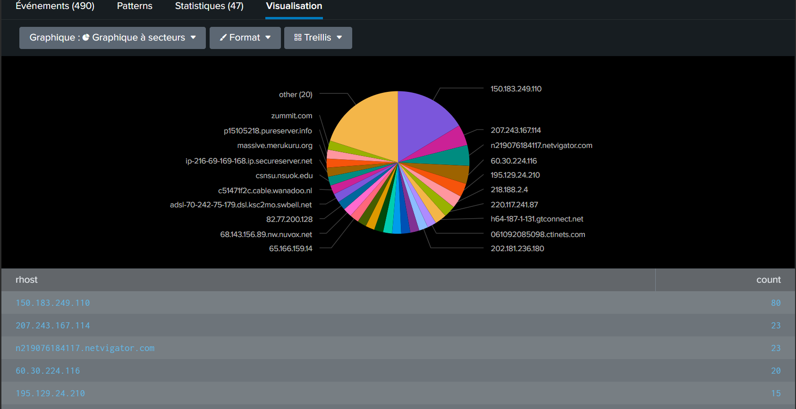
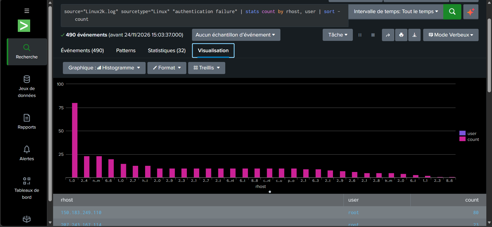
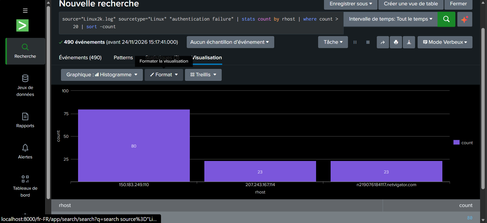

# SOC — Analyse de logs Linux (SSH) & détection d'attaques par force brute

Projet d'analyse de logs dans une démarche SOC : du manuel à l'automatisation,
jusqu'au SIEM. Dataset : `Linux_2k.log` (LogHub, logs académiques publics).

## 🎯 Objectif
Identifier des activités suspectes (force brute SSH, scan de comptes) dans des
logs d'authentification Linux, et formuler des recommandations de remédiation.

## 🧩 Démarche en 3 niveaux

### 1. Analyse manuelle (Power BI)
Import via Power Query, comptage des tentatives par IP source (DAX), scoring
de sévérité. Identification d'un pattern de force brute SSH ciblant `root`.

### 2. Automatisation Python
- **`analyse_logs.py`** : détection des événements suspects par type
  (`authentication failure`, `invalid user`) → export CSV.
  **140 entrées suspectes détectées.**
- **`analyse_ip.py`** : extraction des IP sources par regex et classement des
  plus agressives → export CSV.
  **IP la plus active : `150.183.249.110` (80 tentatives).**

### 3. SIEM — Splunk
Ingestion du fichier de logs dans Splunk Enterprise, puis analyse via le langage de recherche SPL.

- **Ingestion** : upload de `Linux2k.log`, configuration d'un sourcetype personnalisé (`Linux`) et indexation.
- **Détection par mots-clés** : 608 événements suspects identifiés (authentication failure, invalid user, Failed password).
- **Comptage par IP source** : `stats count by rhost` → 47 IP distinctes, dominées par `150.183.249.110` (80 tentatives) — même résultat que l'analyse Python, ce qui valide la cohérence des trois approches.
- **Corrélation IP × compte ciblé** : `stats count by rhost, user` → confirme que le compte `root` est la cible principale.
- **Simulation d'une règle de détection** : `where count > 20` → isole les 3 IP qui dépassent le seuil d'alerte.

**Vue Événements — 608 événements correspondants :**

**Top des IP sources (statistiques) :**

**Corrélation IP × compte ciblé (root) :**

**Simulation d'une règle de détection (seuil > 20) :**

## 🎯 Mapping MITRE ATT&CK

Les activités identifiées dans les logs ont été rapprochées du framework
MITRE ATT&CK, référentiel standard des techniques adverses. Cette mise en
correspondance traduit les observations techniques en langage de threat
intelligence exploitable par une équipe SOC.

| Tactique | Technique | ID | Preuve dans les logs |
|----------|-----------|-----|----------------------|
| Discovery | Account Discovery | [T1087](https://attack.mitre.org/techniques/T1087/) | Tentatives sur comptes inexistants (`invalid user`, `user unknown`) |
| Credential Access | Brute Force | [T1110](https://attack.mitre.org/techniques/T1110/) | 608 échecs d'authentification SSH sur l'ensemble du dataset |
| Credential Access | Brute Force: Password Guessing | [T1110.001](https://attack.mitre.org/techniques/T1110/001/) | Essais répétés sur le compte `root` depuis une IP dominante (150.183.249.110, 80 tentatives) |
| Initial Access / Persistence | Valid Accounts | [T1078](https://attack.mitre.org/techniques/T1078/) | Ciblage du compte `root` — risque de compromission si l'attaque aboutit |

**Interprétation SOC.** La séquence observée — découverte de comptes, puis
force brute concentrée sur `root` — correspond au déroulé classique d'une
intrusion SSH automatisée. La présence de 47 adresses sources distinctes, avec
une IP nettement dominante, oriente vers une attaque distribuée de type botnet.

**Simulation de détection.** Une règle de seuil (`where count > 20`) a été
appliquée pour reproduire la logique d'une alerte SIEM : trois IP dépassent le
seuil d'échecs, confirmant les sources à investiguer en priorité.

## 🔍 Findings clés
- Attaque par force brute SSH automatisée, ciblant principalement `root`.
- Une IP nettement dominante (`150.183.249.110`, 80 tentatives) parmi
  ~47 IP distinctes → possible attaque distribuée / botnet.

## 🛡️ Recommandations
- Blocage des IP identifiées au pare-feu
- Activation de `fail2ban`
- Désactivation de l'authentification `root` en SSH
- Alerte SIEM sur 5+ échecs d'authentification en 60s depuis une même IP

## 🧰 Stack technique
Python (regex, Counter), Power BI (Power Query, DAX), Splunk, analyse de logs
syslog, SOC / threat detection.

## 📁 Contenu du dépôt
- `analyse_logs.py` — détection par type d'événement
- `analyse_ip.py` — classement des IP sources
- `logs_suspects.csv` / `ip_suspectes.csv` — résultats exportés
- `screenshots/` — captures Power BI et sorties terminal
- `Linux_2k.log` — dataset source (LogHub)
